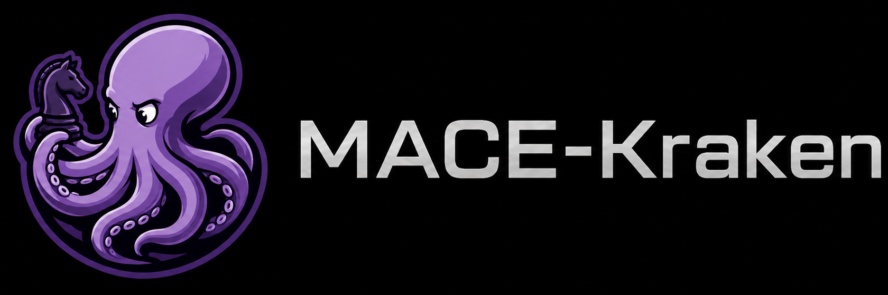

<div align="center">

  

  [![C++20][cpp-badge]][repo-link]
  [![UCI][uci-badge]][repo-link]
  [![Syzygy][syzygy-badge]][fathom-link]
  [![License][license-badge]][license-link]
  [![Commits][commits-badge]][commits-link]

</div>

**MACE-Kraken-v1** (**Magnus Algorithm Chess Engine — Kraken**) is a [C++20][cpp20-link] [UCI][uci-protocol-link] chess engine by Theodore Magnus &Oslash;en Nidhar and the current engine of the MagnusChess family.

The official engine name is **MACE-Kraken-v1**. `MACE` expands to **Magnus Algorithm Chess Engine**, `Kraken` is the engine line, and `v1` is its first public version. It is derived from the MagnusChess family.

MACE-Kraken-v1 communicates over the [Universal Chess Interface][uci-protocol-link], which means you can talk to it in the terminal,
or install it into a UCI-compatible graphical user interface, like [En Croissant](https://encroissant.org/download) or [Nibbler](https://github.com/rooklift/nibbler).

The default evaluator is **P2-H32 MNUE**, maintained separately in [MagnusMNUE](https://github.com/TMagnusN/MagnusMNUE). P2-H32 combines a 768-wide K16 coarse branch with a 256-wide K32 dual-king residual branch and 64 material/king output buckets. MACE-Kraken-v1 also retains the experimental X2-K16-pawn MNUE path for architecture research; X2 is not the current strength target.

MACE-Kraken-v1 supports Chess960 through `setoption name UCI_Chess960 value true`. Position input accepts standard FEN castling tags, X-FEN, and Shredder-FEN file letters. In normal UCI mode castling uses the king destination (`e1g1`); in Chess960 mode it uses the participating rook square (`e1h1`). The engine probes [Syzygy tablebases][syzygy-link] up to 7 pieces through the vendored [Fathom](https://github.com/jdart1/Fathom) backend once no castling rights remain.

PS: MACE-Kraken-v1's MNUE design learned a few architectural lessons from [Reckless](https://github.com/codedeliveryservice/Reckless).

## Building MACE-Kraken-v1

If you only want to build and run the engine, you need a [`g++`][gcc-link] compiler with basic [C++20][cpp20-link] support and [GNU Make][make-link].
For the trainer side of the project, make sure you have [Rust][rust-link] installed.
In my opinion, if you only need the engine, you do not need to install Rust.

0. Make sure your compiler toolchain is installed. On Windows this normally means a [MinGW-w64][mingw-w64-link] / [MSYS2][msys2-link]-style `g++` and `mingw32-make`; on Linux, a recent `g++` and `make`.
1. Clone this repository to your machine via `git clone git@github.com:TMagnusN/MagnusChessX.git`.
2. Enter the source directory via `cd MagnusChessX/Src`.
3. Make sure the embedded network is available. MACE-Kraken-v1 neural networks can be found in the [TMagnusN/MagnusMNUE](https://github.com/TMagnusN/MagnusMNUE) repository. Since the neural network files are large, they are stored separately from the main repository.

   Make sure your machine is connected to the network. The [Makefile](Src/Makefile) will automatically download the default embedded network when it is missing. You can also download the network manually and place it in the `build` directory.

4. Build MACE-Kraken-v1.

   **On Windows**, it is recommended to run
   ```text
   > mingw32-make auto PGO=1 -j
   ```

   **On Linux**, run the same build profile with
   ```text
   > make auto PGO=1 -j
   ```

The `auto` profile automatically detects the CPU flags supported by your machine and optimizes the engine for them. [`PGO=1`][pgo-link] builds an instrumented engine, runs the configured training workload, and then rebuilds the optimized binary.

## Evaluation Development History/Originality (HCE/MNUE)

- First evaluation was a hand-written evaluation function, used mainly to get the engine mechanics into shape: legal move generation, search stability, move ordering, time control behavior, and basic positional sanity.
- The first neural evaluation line replaced HCE with a 768-wide NNUE, moving MACE-Kraken-v1 away from manually stacked evaluation terms and toward a learned evaluator that could be trained, exported, loaded, and checked as part of the normal engine loop.
- The current normal evaluation line is P2-H32 MNUE. Its canonical horizontal mapping, hybrid K16/K32 branches, and bucketed scalar head form the default path used in ordinary play.
- Subsequent experimental work added the X2-K16-pawn MNUE path. X2 is not just a wider P2 network: it separates piece, attack-edge, and pawn-pair feature families, which makes it useful for testing whether a richer feature layout can represent tactical and structural information more directly.
- X2 is treated as experimental because an interesting architecture is not the same thing as proven strength. It exists in the engine so feature parity, loading, evaluation dispatch, and runtime behavior can be tested against the same search code as P2-H32.
- Regular engine testing is kept on `UHO_4060_v4.epd` and a private [OpenBench][openbench-link] instance, so changes are compared against a fixed opening set instead of whatever positions happen to be convenient that day.

All neural-network architecture work currently used in MACE-Kraken-v1 is designed for MACE-Kraken-v1 and trained with [bullet](https://github.com/jw1912/bullet).
Current training data is generated with [Stockfish tooling](https://github.com/official-stockfish/Stockfish/tree/tools), so the project does not claim original self-play-only training data.
The current P2/P2-H32 trainer commands and embedded-network workflow are documented in [Notes/MNUE_P2_TRAINER.md](Notes/MNUE_P2_TRAINER.md).

## Thanks and Acknowledgements

[Fathom](https://github.com/jdart1/Fathom), used for Syzygy tablebase probing. MACE-Kraken-v1 relies on it for practical endgame tablebase support instead of carrying its own tablebase probe implementation.

[bullet](https://github.com/jw1912/bullet), used for neural-network training. It provides the training side that makes the MNUE experiments more than just file formats and engine loaders.

[Stockfish tooling](https://github.com/official-stockfish/Stockfish/tree/tools), used for training data generation.

[Reckless](https://github.com/codedeliveryservice/Reckless), whose public architecture helped inform parts of the MNUE design. MACE-Kraken-v1 does not copy Reckless code; the useful lessons are re-derived inside its own network format, feature encoders, and validation workflow.

MACE-Kraken-v1 is distributed under the MIT License. See [LICENSE][license-link].

[repo-link]: https://github.com/TMagnusN/MagnusChessX
[fathom-link]: https://github.com/jdart1/Fathom
[commits-link]: https://github.com/TMagnusN/MagnusChessX/commits/main
[license-link]: https://github.com/TMagnusN/MagnusChessX/blob/main/LICENSE
[cpp20-link]: https://en.cppreference.com/w/cpp/20
[uci-protocol-link]: https://www.shredderchess.com/chess-features/uci-universal-chess-interface.html
[gcc-link]: https://gcc.gnu.org/
[make-link]: https://www.gnu.org/software/make/
[msys2-link]: https://www.msys2.org/
[mingw-w64-link]: https://www.mingw-w64.org/
[rust-link]: https://www.rust-lang.org/tools/install
[syzygy-link]: https://syzygy-tables.info/
[pgo-link]: https://gcc.gnu.org/onlinedocs/gcc/Optimize-Options.html#index-fprofile-generate
[openbench-link]: https://github.com/AndyGrant/OpenBench

[cpp-badge]: https://img.shields.io/badge/C%2B%2B-20-blue?style=for-the-badge
[uci-badge]: https://img.shields.io/badge/Protocol-UCI-brightgreen?style=for-the-badge
[syzygy-badge]: https://img.shields.io/badge/Syzygy-7--piece-informational?style=for-the-badge
[license-badge]: https://img.shields.io/badge/License-MIT-success?style=for-the-badge
[commits-badge]: https://img.shields.io/github/last-commit/TMagnusN/MagnusChessX/main?style=for-the-badge&label=last%20commit
